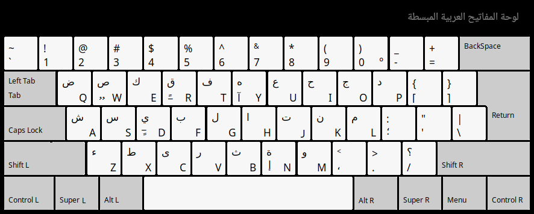
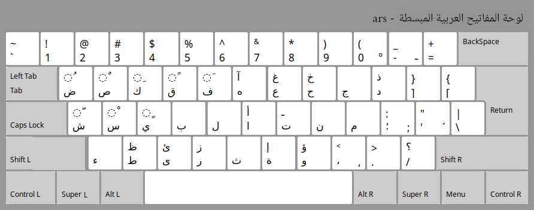

# Simplified Arabic Keyboard Layout (ars) 

## Overview

This repository provides an improved Arabic character layout for the 
**bilingual QWERTY Arabic-English** keyboard.

The improvements aim to reduce finger movement and make character positions easier to memorize.

* A first simplification is to use the same keys for symbols
and punctuation in both the Arabic and English keyboards layouts.
* Another simplification is to place similarly shaped Arabic characters on the same key, using **Shift** to access one of them. 
* Arabic vowels are arranged according to the first letter of each vowel's name.

### Bilingual `"ars"` Arabic-English QWERTY keyboard 



### The `"ars"` Arabic keyboard layout



## Repository Structure

```
.
├── linux/
│     └── symbols/
│           └── ars					# simplified Arabic keyboard layout for linux
│     └── rules/
│           └── evdev.xml			# for GNOME, Plasma (KDE)
│     └── xsessionrc				# my ~/.xsessionrc for LXDE 
│     └── ars-variant.png			# image "ars" variant numbers : ١٢٣٤٥٦٧٨٩٠ 
├── windows/
│     └── ars-install/				# simplified Arabic keyboard layout for Windows
│       └── setup.exe ...           # created using MSKLC.exe 
│     └── arsc-install/...			# "arsc" ("ars" variant) numbers : ١٢٣٤٥٦٧٨٩٠
│     └── images/ 			        # images 
├── README.md
├── README-En.md
└── ars.png                     
└── ars-qw.png                      # Layout of the physical Arabic QWERTY keyboard (ars)
└── ars-color.png			

```

## Quick Start

To implement the `"ars"` keyboard layout 


### Linux

#### GNOME or Plasma (KDE)
1. Copy the `ars` file to `/usr/share/X11/xkb/symbols/` folder 
on your local system
2. Copy the `evdev.xml` file to 
`/usr/share/X11/xkb/rules/` folder on your local system. 
3. Run `udevadm trigger --subsystem-match=input --action=change` or reboot 
 
#### LXDE
1. Copy the `ars` file to `/usr/share/X11/xkb/symbols/` folder
on your local system
2. Add the command line  
 `setxkbmap "us,ars" -variant "," -option "grp:lwin_toggle,grp_led:caps";`  
to your `~/.xsessionrc` file.
3. Execute logout or reboot
- Remark : for ars (variant), in 2. replace `","` by `",c"` 
 
### Windows
- Copy `ars-install/` folder and execute `setup.exe`.
- Remark : `"install/"` folder created using `Microsoft Keyboard Layout Creator` (MSKLC.exe)

## License
This repository is licensed under `MIT License`. 

