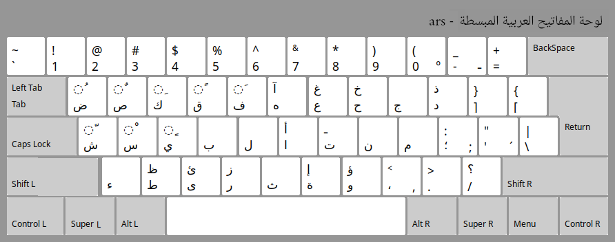
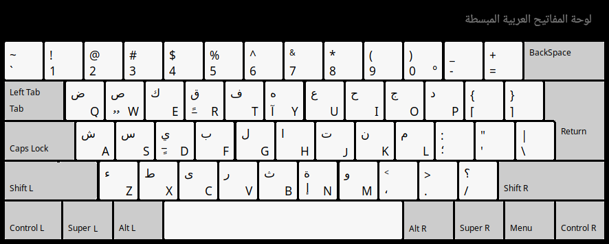

<div dir="rtl" lang="ar">
# تخطيط لوحة مفاتيح عربية مبسّط (ars)

## نظرة عامة

يوفّر هذا المستودع تخطيطًا محسّنًا للأحرف العربية على لوحة مفاتيح **QWERTY ثنائية اللغة (عربية-إنجليزية)**.

تهدف التحسينات إلى تقليل حركة الأصابع وتسهيل حفظ مواضع الأحرف.

* يتمثّل التبسيط الأول في أن مفاتيح الرموز و الأرقام هي نفسها في لوحات العربية و الإنجليزية.
* تبسيط أخر يكمن في وضع الأحرف العربية المتشابهة على مفتاح واحد، مع استخدام **Shift** للوصول إلى أحدها.
* رُتّبت الحركات العربية بحسب الحرف الأول من اسم كل حركة.

### تخطيط لوحة المفاتيح `"ars"`



## بنية المستودع

```text
.
┤── linux/
│     ┘── symbols/
│           ┘── ars                    # تخطيط لوحة مفاتيح عربية مبسّط لنظام Linux
│     ┘── rules/
│           ┘── evdev.xml               # لـ GNOME وPlasma (KDE)
│     ┘── xsessionrc                    # ملف ~/.xsessionrc الخاص بي لـ LXDE
│     ┘── ars-variant.png               # صورة أرقام النسخة «ars»: ١٢٣٤٥٦٧٨٩٠
│     ┘── ars-color.png               
┤── windows/
│     ┘── ars-install/                  # تخطيط لوحة مفاتيح عربية مبسّط لنظام Windows
│       ┘── setup.exe ...               # أُنشئ باستخدام MSKLC.exe
│     ┘── arsc-install/...              # أرقام النسخة «arsc» (إحدى نسخ «ars»): ١٢٣٤٥٦٧٨٩٠
│     ┘── images/                       # صور
┤── README.md
┤── README-English.md
┘── ars.png
┘── ars-qw.png                          # تخطيط لوحة مفاتيح QWERTY العربية الفعلية (ars)
```

## البدء السريع

لتفعيل تخطيط لوحة المفاتيح `"ars"`:

### Linux

#### GNOME أو Plasma (KDE)

1. انسخ الملف `ars` إلى المجلد `/usr/share/X11/xkb/symbols/` على نظامك المحلي.
2. انسخ الملف `evdev.xml` إلى المجلد `/usr/share/X11/xkb/rules/` على نظامك المحلي.
3. شغّل الأمر `udevadm trigger --subsystem-match=input --action=change` أو أعد تشغيل النظام.

#### LXDE

1. انسخ الملف `ars` إلى المجلد `/usr/share/X11/xkb/symbols/` على نظامك المحلي.
2. أضف سطر الأوامر التالي إلى ملف:
 `~/.xsessionrc`   
 `setxkbmap "us,ars" -variant "," -option "grp:lwin_toggle,grp_led:caps"`
3. نفّذ الأمر `xrdb -merge ~/.xsessionrc` أو أعد تشغيل النظام.

- ملاحظة: لاستخدام نسخة `ars`، استبدل `","` في الخطوة 2 بـ `",c"`.

### Windows

- انسخ المجلد `ars-install/` وشغّل `setup.exe`.
- ملاحظة: أُنشئ المجلد `"install/"` باستخدام `Microsoft Keyboard Layout Creator` (MSKLC.exe).

### تخطيط لوحة مفاتيح QWERTY فعلية ثنائية اللغة (عربية-إنجليزية) `"ars"`



## الترخيص

هذا المستودع مرخّص بموجب **رخصة MIT**.
</div>
